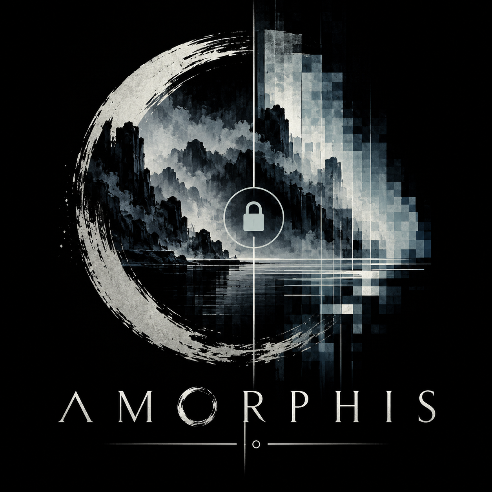

<p align="center"></p>

<h1 align="center">Amorphis</h1>

<p align="center">A small, fail-closed screen locker for Wayland and X11.</p>

---

Amorphis is a security-first screen locker in the spirit of `slock`: one small
program, PAM authentication, real locking mechanisms for both display systems,
and optional blurred or pixelated backgrounds without turning the lock screen
into a desktop shell.

It is still pre-release software. The Wayland backend has been smoke-tested on
Wasp and the X11 backend on Xorg, but the full compositor, multi-monitor,
suspend/resume, and hostile-input test matrix is not complete. Do not yet rely
on Amorphis as the sole protection for an important session.

## Features

- **Real Wayland locking** — uses `ext-session-lock-v1`; it never substitutes a
  fullscreen, layer-shell, or XWayland window for a session lock.
- **Real X11 backend** — creates opaque override-redirect windows and verifies
  both keyboard and pointer grabs, with RandR resize handling.
- **PAM authentication** — shares one fail-closed authentication path across
  both backends and never places passwords in logs, arguments, or files.
- **Safe background fallback** — custom PNG → embedded branded image → opaque
  solid colour. A broken or oversized image never prevents the session locking.
- **Blur and pixelation** — `blur`, `pixelate`, or both, processed in a bounded
  worker after the first opaque frame is established.
- **Per-output desktop capture** — X11 root capture and native Wayland capture
  through `ext-image-copy-capture-v1`, with no portal prompt or screenshot
  daemon.
- **Predictable image fitting** — `cover`, `contain`, and `center`, with explicit
  image dimension and memory limits.

## Installing

<details>
<summary><b>Void Linux</b></summary>

Install the build dependencies:

```sh
sudo xbps-install -S rust cargo pkg-config pam-devel \
  libxkbcommon-devel libxcb-devel wayland-devel
```

Build and install Amorphis and its PAM policy:

```sh
git clone https://github.com/dani-77/amorphis.git
cd amorphis
cargo build --release
sudo install -Dm755 target/release/amorphis /usr/local/bin/amorphis
sudo install -o root -g root -m0644 \
  contrib/pam/amorphis.void /etc/pam.d/amorphis
```
</details>

<details>
<summary><b>Build from source (other distributions)</b></summary>

Amorphis needs a Rust toolchain plus development headers for PAM, XKB Common,
XCB, and Wayland. Package names vary by distribution.

```sh
git clone https://github.com/dani-77/amorphis.git
cd amorphis
cargo build --release
```

Before running it, install a distribution-appropriate PAM policy named
`amorphis`. Starting points and the associated lockout warning are in
[`contrib/pam/README.md`](contrib/pam/README.md).
</details>

## Using it

Both backends use the embedded branded background by default:

```sh
amorphis --backend wayland
amorphis --backend x11
```

Use a custom PNG and choose how it fits the output (the examples use Wayland;
replace it with `x11` to use the X11 backend):

```sh
amorphis --backend wayland --image /path/to/background.png --fit cover
```

Apply blur, pixelation, or both:

```sh
amorphis --backend wayland --image /path/to/background.png \
  --effect blur-pixelate --blur-radius 16 --pixel-size 16
```

Capture the current desktop before covering it and apply the same effects in
memory:

```sh
amorphis --backend wayland --capture \
  --effect blur-pixelate --blur-radius 16 --pixel-size 16
```

Replace `wayland` with `x11` to use X11 root capture. On Wayland, `--capture`
requires both `ext-output-image-capture-source-v1` and
`ext-image-copy-capture-v1`. If capture is unavailable, refused, times out, or
offers no supported SHM format, Amorphis uses the embedded image and finally
the solid colour without cancelling the lock.

The effects also work with the embedded image when `--image` is omitted. Use
the final solid-colour fallback explicitly with:

```sh
amorphis --backend wayland --solid
amorphis --backend x11 --solid
```

Type the account password and press `Enter` to unlock. Input is deliberately
hidden; `Backspace` removes one character, `Ctrl+U` or `Escape` clears the
current entry, and a failed authentication attempt leaves the session locked.

Amorphis always covers every output/root advertised by the display server. It
does not offer selective per-monitor locking; newly connected outputs receive
an opaque solid frame even when no pre-lock capture exists for them.

## Current status

The Wayland path has been tested on Wasp 0.9.1 / wlroots 0.20.2 with PAM, the
embedded fallback, a 7680×4320 custom PNG, native desktop capture, and combined
blur/pixelation. The X11 path has been tested in a real Xorg session with
keyboard and pointer capture, PAM unlock, the embedded fallback, blur, and
pixelation, including desktop capture with the combined effect. The wider
security matrix still requires live testing. X11 desktop capture has also been
smoke-tested under Xephyr. Wayland per-output capture has been smoke-tested on
a nested Wasp instance with two virtual outputs and distinct content on each;
physical multi-monitor and broader compositor testing remain pending.

See [SECURITY.md](SECURITY.md) before relying on either backend. X11 cannot
retain a lock if the process or X server is killed; Wayland support depends on
the compositor advertising `ext-session-lock-v1`.

## Development

```sh
cargo test
cargo clippy --all-targets -- -D warnings
cargo fmt --check
```

With Xephyr and ImageMagick installed, the disposable two-screen X11 smoke test
also checks per-root capture and RandR resizing without locking the host display:

```sh
contrib/tests/x11-multiscreen-smoke.sh
```

The design, security boundaries, implementation plan, and remaining acceptance
tests are documented in:

- [`AMORPHIS_DIRECAO.md`](AMORPHIS_DIRECAO.md)
- [`AMORPHIS_PROPOSTA_TECNICA.md`](AMORPHIS_PROPOSTA_TECNICA.md)

## License

MIT — see [LICENSE](LICENSE).
